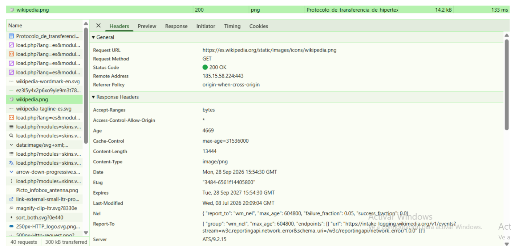
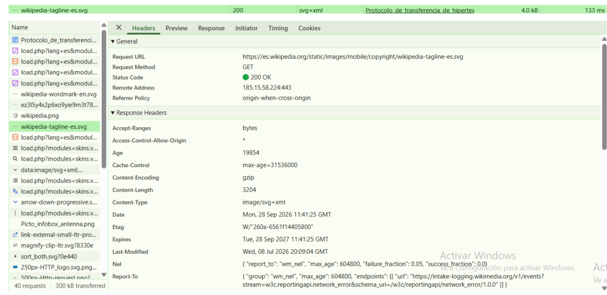
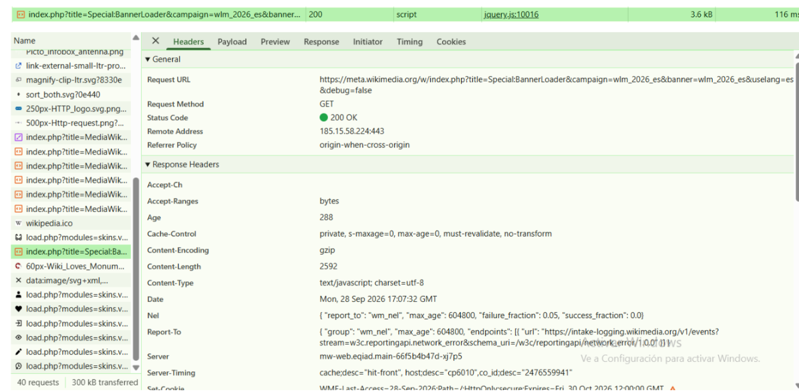

# Mini-proyecto UT 1

## Web elegida

La web elegida para realizar este análisis es **Wikipedia**, concretamente una página de Wikipedia en español:

https://es.wikipedia.org/wiki/HTTP

## Integrantes

* Francisco Montero Acosta
* Enrique Montero Acosta

## 1. Frontend y backend

### Frontend

El **frontend** es la parte de la web que recibe y utiliza el usuario directamente. En Wikipedia, el frontend incluye elementos como:

* La estructura y el contenido de las páginas.
* Los textos, títulos, menús y enlaces.
* Los estilos visuales de la página.
* Las imágenes y otros elementos que aparecen en el navegador.
* El código JavaScript que permite determinadas funciones e interacciones.

El frontend se ejecuta principalmente en el navegador del usuario.

### Backend

El **backend** es la parte que funciona en los servidores de Wikipedia y que el usuario no ve directamente.

Se encarga, entre otras cosas, de:

* Recibir las peticiones del navegador.
* Buscar y preparar la información solicitada.
* Generar o enviar los recursos necesarios.
* Procesar las peticiones HTTP.
* Devolver las respuestas al navegador.

El backend se ejecuta en los servidores de la plataforma.

## 2. Modelo cliente-servidor

Wikipedia utiliza el modelo **cliente-servidor**.

El **cliente** es nuestro navegador, por ejemplo Google Chrome, Firefox o Microsoft Edge.

El **servidor** es el sistema informático de Wikipedia que recibe las peticiones y responde con los recursos solicitados.

El funcionamiento básico es el siguiente:

1. El usuario escribe una dirección de Wikipedia en el navegador.
2. El navegador actúa como cliente y realiza una petición HTTP al servidor.
3. El servidor recibe la petición.
4. El servidor procesa la solicitud y devuelve una respuesta HTTP.
5. La respuesta puede contener HTML, CSS, JavaScript, imágenes u otros recursos.
6. El navegador recibe esos recursos y construye la página que vemos en pantalla.

Por ejemplo, cuando accedemos a una página de Wikipedia, el navegador puede realizar varias peticiones para obtener el documento HTML y también otros recursos necesarios para mostrar correctamente la página.

## 3. Análisis de peticiones HTTP

Mediante las herramientas de desarrollador del navegador, en la pestaña **Network**, podemos observar las peticiones realizadas por la web.

### Petición 1
* **Nombre:** wikipedia.png
* **Método:** GET
* **Código de estado:** 200
* **Tipo de contenido:** image/png

Esta petición solicita una imagen utilizada en la página web.

### Petición 2
* **Nombre:** wikipedia-tagline-es.svg
* **Método:** GET
* **Código de estado:** 200
* **Tipo de contenido:** image/svg+xml

Esta petición solicita al servidor una imagen en formato SVG que se utiliza en la página web.

### Petición 3
* **Nombre:** index.php
* **Método:** GET
* **Código de estado:** 200
* **Tipo de contenido:** text/javascript

Esta petición solicita al servidor un archivo JavaScript utilizado por la página web.

## 4. Conclusión

El análisis de Wikipedia permite relacionar los conceptos estudiados en el Bloque 1. El navegador actúa como cliente, mientras que Wikipedia dispone de servidores que reciben las peticiones HTTP y devuelven las respuestas correspondientes.

Además, mediante la pestaña Network de DevTools podemos observar cómo el navegador realiza diferentes peticiones para obtener HTML, CSS, imágenes y otros recursos necesarios para mostrar la página.
